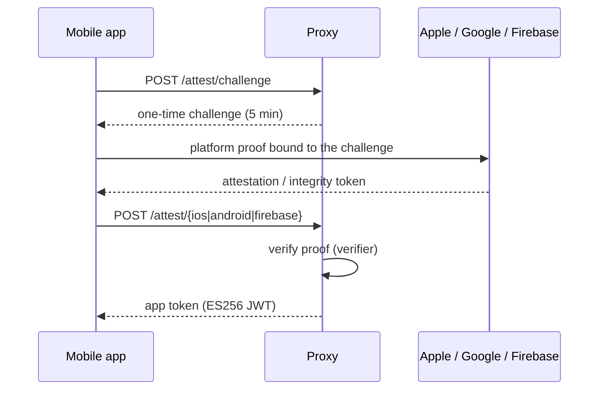
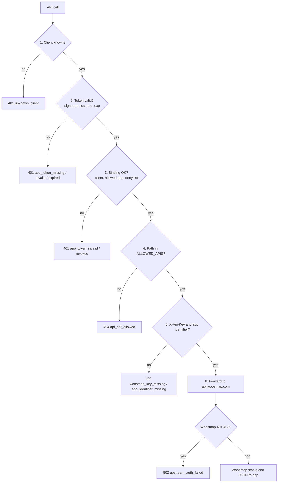

# Proxy architecture: attestation and API call validation

How the Woozies proxy decides that a request comes from a genuine app, and what that costs in checks and external calls. For setup, see the [README](../README.md).

## Overview

The proxy separates two jobs:

1. **Attestation, rarely:** the app proves it's genuine with App Attest, Play Integrity or Firebase App Check. In return the proxy gives it a short-lived **app token** (an ES256 JWT, valid 30 minutes by default).
2. **Validation, on every call:** each Woosmap API call carries the app token. The proxy checks it locally, then forwards the call to `api.woosmap.com`.

The expensive work (certificate chains, Google verdicts) happens once per token. Each API call then costs only one local signature check.

| Component | Code | Role |
| --- | --- | --- |
| Attestation endpoints | `proxy/woozies_proxy/main.py` (`/attest/*`) | Issue challenges, run a verifier, issue tokens |
| Verifiers | `proxy/attestation/app_attest.py`, `play_integrity.py`, `firebase_app_check.py` | Check each platform's proof |
| Token issuer and verifier | `proxy/attestation/tokens.py` | Sign and verify app tokens |
| Gate | `proxy/attestation/gateway.py` (`AppTokenGate`) | Check the app token on every API call |
| API route | `proxy/woozies_proxy/main.py` (`woosmap_api`) | Allow-list, header checks, forwarding |
| Store | `proxy/attestation/store.py` | Challenges, App Attest keys, deny list (in memory) |

## Getting an app token

Challenges are single-use, expire after 5 minutes, and are bound to the client (`X-Client-Id`), so a captured proof can't be replayed.

### Verifiers

| Platform | Function | What it checks |
| --- | --- | --- |
| iOS, first registration | `AppAttestVerifier.verify_attestation` | Certificate chain up to Apple's root CA, that the nonce matches the challenge, that `rpIdHash` matches `<Team ID>.<bundle ID>` for a bundle ID in `IOS_BUNDLE_IDS`, and the key ID |
| iOS, refresh | `AppAttestVerifier.verify_assertion` | Signature with the registered key, the App ID, and that the counter increases (stops replay) |
| Android | `PlayIntegrityVerifier.verify` | Nonce, package (in `ANDROID_PACKAGES`), signing cert (`ANDROID_CERT_SHA256`), `PLAY_RECOGNIZED`, `MEETS_DEVICE_INTEGRITY`, and that the verdict is at most 5 minutes old |
| Firebase | `FirebaseAppCheckVerifier.verify` | Signature with Firebase's keys, the project, and that the app ID is in `FIREBASE_APP_IDS` |
| Simulator / emulator | `debug_token` endpoint | Token in `ATTEST_DEBUG_TOKENS`, and that the app is listed. Development only. |

If the proof checks out, `TokenIssuer.issue` signs a token with these claims:

| Claim | Meaning |
| --- | --- |
| `wk` | Client ID the token is bound to |
| `app` | Bundle ID, package or Firebase app ID |
| `plt` | `ios` or `android` |
| `att` | Attestation method, for example `app_attest` or `play_integrity` |
| `sub` | Device or key identifier |
| `exp` | Expiry time |

### Several apps

One proxy serves every app listed in `IOS_BUNDLE_IDS`, `ANDROID_PACKAGES` and `FIREBASE_APP_IDS`:

- **iOS:** the attestation is matched against each listed bundle ID, so the app doesn't need to say which it is.
- **Android:** the app names its package in `X-Android-Identifier`, and Google decodes the token for that package.

## Validating an API call

| Step | Code | Checks |
| --- | --- | --- |
| 1 | `AppTokenGate.evaluate` | `X-Client-Id` is in the registry |
| 2 | `TokenVerifier.verify` | Signature, `kid`, issuer, audience, expiry, required claims |
| 3 | `AppTokenGate._check` | Token client equals `X-Client-Id`; app still allowed (skipped for debug tokens); client, app and device not denied |
| 4 | `woosmap_api` | Exact match against `ALLOWED_APIS` |
| 5 | `woosmap_api` | `X-Api-Key`, plus `X-iOS-Identifier` or `X-Android-Identifier` |
| 6 | `woosmap_api` | Drops `key` and `private_key` from the query string, then forwards the key, platform headers, `Accept-Language`, and for POST the body |

`ATTEST_MODE` controls steps 1–3:

| Mode | Steps 1–3 |
| --- | --- |
| `enforce` | A failure is rejected |
| `monitor` | A failure is logged, and the call is forwarded anyway |
| `off` | The checks are skipped |

When the app gets an `app_token_*` 401, it attests again once and retries the call.

## External calls

### On each API call

Only the forward to Woosmap. Every check before it uses data already in memory:

| Check | Data source | Network |
| --- | --- | --- |
| Client lookup | Registry built from settings | No |
| Token signature | The proxy's own public key | No |
| Binding and deny list | Token claims and the in-memory store | No |
| Allow-list and headers | Settings and the request | No |
| Forward | `api.woosmap.com` | Yes |

An outage at Apple, Google or Firebase doesn't affect apps that already hold a valid token.

### When getting a token

Calls to third parties per token. Calls from the app to the proxy are listed separately.

| Path | From the device | From the proxy | Total | App → proxy |
| --- | --- | --- | --- | --- |
| iOS, first registration | 1 (Apple `attestKey`) | 0: chain checked offline | 1 | 2 |
| iOS, refresh | 0: assertion signed on the device | 0 | 0 | 2 |
| Android, every token | 1 (Play Integrity) | 1 (`decodeIntegrityToken`), plus an OAuth refresh about once an hour | 2–3 | 2 |
| Firebase App Check | 1–2 (provider, then the swap with Firebase); cached by the SDK | 0, plus a key fetch at most once an hour | 0–2 | 1 |
| Debug token | 0 | 0 | 0 | 1 |

- **iOS:** Apple is contacted once per install. Refreshes are free.
- **Android:** every token, including each refresh, costs Google calls against the Play Integrity daily quota (10,000 a day by default; Google raises it on request). To use less, raise `TOKEN_TTL_SECONDS` (maximum 3600) or move to Play Integrity standard requests.

## Known limitations

| Limitation | Impact | Fix |
| --- | --- | --- |
| The proxy forwards the key the app sends | The key ships in the app; anyone who extracts it can call Woosmap directly with the identifier header, skipping the proxy | The proxy holds an IP-restricted server key, and the apps ship none |
| The token's `app` isn't checked against the identifier header | A token earned by app A can be sent with app B's headers | Compare `app` with `X-iOS-Identifier` / `X-Android-Identifier` at step 5 |
| The proxy trusts the Team ID the app sends | Attestation proves *some* team signed the bundle ID | Safe while the bundle ID is registered to your team; otherwise configure the Team ID |
| State is in memory | Restarts lose App Attest keys, challenges and the deny list; several instances can't share it | Redis for challenges, a database for keys and the deny list |
| Nothing fills the deny list | Tokens can't be revoked early | An admin endpoint backed by shared storage |
| No `ATTEST_SIGNING_KEY` means a new key on every start | A restart invalidates every token, and instances reject each other's tokens | Set a persistent signing key |
| Not tested on real devices | App Attest and Play Integrity are covered by tests with fakes and by simulator/emulator debug tokens only | Test on hardware; for Play Integrity, install from a Play testing track |
